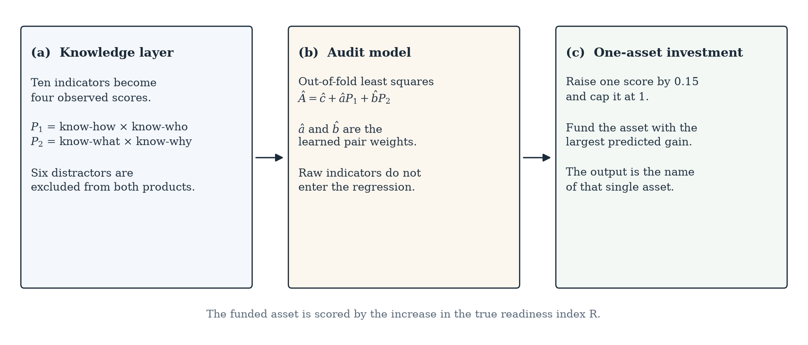
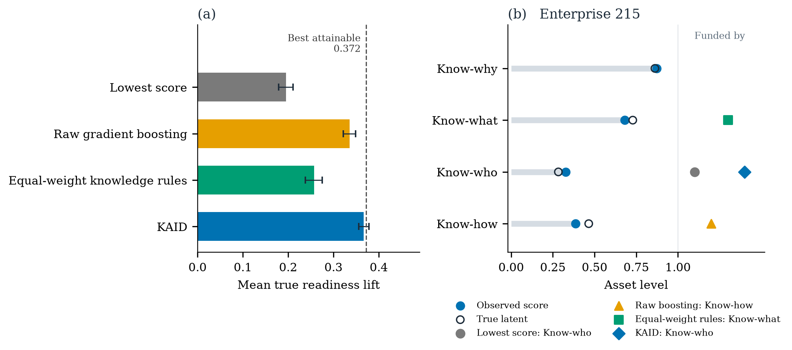

# A knowledge-based AI decision-support model for predicting digital transformation readiness from enterprise innovation data

Short Communication

Durga Rao Palagiri a,*

a Affiliation and postal address, including country, to be completed before submission.

\* Corresponding author. E-mail address to be completed before submission.

## Abstract

Digital-transformation readiness is usually reported as a score, so the funding decision remains open. This short communication presents a knowledge-guided artificial-intelligence decision model (KAID) that names one knowledge asset to fund. Ten innovation indicators are averaged into know-how, know-who, know-what, and know-why. Two rules form the products know-how × know-who and know-what × know-why. Ordinary least squares with an intercept, fitted out-of-fold to a noisy readiness audit, learns the relative weight of those products. The action raises one asset by 0.15, capped at 1, and keeps the asset with the largest predicted increase in the audit. Across 360 reproducible enterprises, KAID achieved a hit rate of 0.889 and a mean true readiness lift of 0.367, against a best attainable lift of 0.372. Equal-weight knowledge rules reached 0.257, raw gradient boosting reached 0.336, and funding the lowest score reached 0.195. Holm-adjusted paired tests give p = 1.42 × 10^{-13} against raw boosting and p = 3.75 × 10^{-31} against equal-weight rules. The same ordering holds at investment steps of 0.10 and 0.20. The enterprises come from a disclosed simulation, so the correct asset is known. The study includes no field survey and no estimate for a named industry.

**Keywords:** knowledge-based systems; digital transformation; innovation data; decision support; complementarity; readiness; entrepreneurship

## 1. Introduction

An entrepreneurial firm that can fund only one knowledge asset needs the name of that asset. Training, research and development, cooperation with customers, suppliers, and universities, product innovation, and scientific sourcing are often already recorded. A readiness score does not say whether the scarce investment is a skill, a partner, or a research link.

Digital transformation is the setting for that choice. Vial [1] describes it as a process that alters an entity through combinations of information, computing, communication, and connectivity technologies. Verhoef and colleagues [2] locate the failure of transformation in missing capabilities. Matt, Hess, and Benlian [3] treat the response as a strategic decision. Entrepreneurial firms meet the choice before the knowledge base that would sustain a digital offering is in place [4].

Michelotto and Joia [5] show that organizational readiness is a set of capabilities, so one number does not name the next action. Trstenjak and colleagues [6] use a decision-support system to turn an Industry 4.0 readiness factor into a manufacturing transition step. That step is not a choice among the knowledge assets in an innovation record.

Grant [7] treats the firm as an institution for integrating specialized knowledge. Lundvall and Johnson [8] divide that knowledge into know-what, know-why, know-how, and know-who. Cohen and Levinthal [9] tie the use of scientific sources to absorptive capacity. Teece [10] separates sensing a weak capability from seizing the investment that repairs it. Liang and Li [11] find that digital transformation changes innovation by changing how innovation decisions are structured. Mikalef and Gupta [12] treat an artificial-intelligence capability as a bundle of complementary resources. Warner and Wäger [13] describe sensing and seizing as strategic renewal. These studies name the assets and the seizing decision. They do not supply the rule that converts one enterprise’s indicators into the single asset to fund.

That rule is the contribution, and readiness is not redefined. Two production rules state the complementarities. A linear audit learns their relative weight. The output is one funded asset. KAID is the model that carries the rule. The matched test compares it, on 360 enterprises, with a lowest-score heuristic, equal-weight copies of the same rules, and gradient boosting on the raw indicators. Equal-weight rules keep the pairs and withhold the imbalance. Raw gradient boosting keeps a flexible fit and receives no pairs. Section 2 states the rules. Section 3 states the test. Section 4 reports whether the learned weights change the funded asset.

## 2. Proposed KAID framework

Fig. 1 follows one enterprise from its innovation indicators to one funded asset. The knowledge layer fixes the grouping and the two products. The audit estimates the weight of each product. The investment layer spends the step on one asset.

**Fig. 1.** KAID decision-support framework. **(a)** Ten innovation indicators are averaged into four knowledge assets and the products in Eq. (1). **(b)** An out-of-fold linear audit learns the intercept and the two pair weights in Eq. (3). **(c)** One asset is raised by 0.15, capped at 1, and the asset with the largest predicted gain is funded.

### 2.1 Knowledge assets and the readiness index

The grouping is fixed before any audit is fitted. Know-how is the mean of training intensity, process innovation, and research-and-development intensity. Know-who is the mean of cooperation with customers, suppliers, and universities. Know-what is the mean of product innovation and the share of sales from innovation. Know-why is the mean of scientific sourcing and the share of research-driven projects. Each indicator is clipped to the unit interval before the mean is taken, so the observed asset scores \(s_1, s_2, s_3, s_4\) lie in \([0, 1]\).

Six further indicators — plant age, fleet size, unrelated certifications, office count, vehicle age, and storage area — vary across enterprises and are excluded from the readiness index. Section 3 makes them available to the raw-indicator baseline and keeps them out of KAID.

The two knowledge rules are the products of the observed scores:

\[
P_1 = s_1 s_2, \qquad P_2 = s_3 s_4. \tag{1}
\]

Eq. (1) states that an asset pays through its partner. Know-how without know-who, and know-what without know-why, do not enter the audit. The true readiness index, which the decision maker does not observe, uses the latent levels \(z_1, z_2, z_3, z_4\) of the same four assets:

\[
R = 4.0 \, z_1 z_2 + 0.9 \, z_3 z_4. \tag{2}
\]

The coefficients 4.0 and 0.9 are part of the disclosed data-generating process. An equal-weight use of Eq. (1) is a genuine comparator: it keeps the products and assigns them equal coefficients. The observed audit is \(A = R + \varepsilon\), where \(\varepsilon\) is normal noise with standard deviation 0.10. Every method that learns from data sees \(A\) and the indicators. No method sees \(R\) or \(z\).

### 2.2 Audit model

KAID regresses the audit on the two products in Eq. (1) and on nothing else. The implemented estimator is ordinary least squares with an intercept:

\[
\hat{A} = \hat{c} + \hat{a} P_1 + \hat{b} P_2. \tag{3}
\]

The intercept \(\hat{c}\) shifts the level of the audit. The slopes \(\hat{a}\) and \(\hat{b}\) are the learned pair weights, and they are the quantities that enter the investment rule in Eq. (5). Those slopes are estimated with the intercept present. The fit is out-of-fold: the enterprise being advised is absent from the rows that estimate the weights used to advise it. The linear form is fixed by Eq. (2), so tree depth is not a parameter of KAID.

After the fit, \(\hat{a}\) and \(\hat{b}\) identify which complementarity the audit is paying for. Yang and colleagues [14] represent uncertain domain knowledge as a belief-rule base whose inference can be inspected. Nimmy and colleagues [15] show that a glass-box rule trace can be checked without attaching an explanation after a black-box decision. Elgargouh and colleagues [16], reviewing insurance firms, find that digital transformation depends on processes that identify and use knowledge the firm already holds. KAID uses that requirement on an innovation record: the rules are the products, and the audit sets their weights. A tree model of the raw indicators is retained as a baseline because it can ignore that form [17]. The implementation uses scikit-learn [18].

### 2.3 One-asset investment

The firm can fund one asset. Funding asset \(j\) raises its observed score by a step \(\delta\), capped at 1:

\[
s_j^{+} = \min(1, s_j + \delta). \tag{4}
\]

KAID chooses the asset that most increases the fitted audit. With \(\Delta_j \hat{A}\) the change in Eq. (3) after the step in Eq. (4),

\[
j^{\star} = \arg\max_j \Delta_j \hat{A}. \tag{5}
\]

Because Eq. (3) is linear, the intercept cancels inside \(\Delta_j \hat{A}\). The action depends on \(\hat{a}\) and \(\hat{b}\), and those slopes were estimated with the intercept present. In the main experiment \(\delta = 0.15\). The same rule is repeated at 0.10 and 0.20. The claim is the ordering of the four rules, and that ordering is estimated again at each step.

The score for a choice is the increase in \(R\) when the same step, with the same cap, is applied to the latent asset \(z_j\). That latent lift is the evaluation target. Algorithm 1 does not receive it.

**Algorithm 1.** KAID investment choice

**Input:** indicator matrix; audit vector; step \(\delta\); number of folds  
**Output:** one funded asset per enterprise

1. Average the indicators of each asset to obtain \(s_1, \ldots, s_4\).
2. Form the pair products \(P_1\) and \(P_2\) in Eq. (1).
3. **for** each held-out fold **do**
4. &nbsp;&nbsp;Fit Eq. (3), including the intercept, on the complementary folds.
5. &nbsp;&nbsp;**for** each held-out enterprise **do**
6. &nbsp;&nbsp;&nbsp;&nbsp;Raise each asset in turn by \(\delta\) as in Eq. (4).
7. &nbsp;&nbsp;&nbsp;&nbsp;Recompute \(P_1\) and \(P_2\) and record \(\Delta_j \hat{A}\).
8. &nbsp;&nbsp;&nbsp;&nbsp;Recommend the asset in Eq. (5).
9. &nbsp;&nbsp;**end for**
10. **end for**
11. **return** the recommended asset for every enterprise.

## 3. Experimental design

The benchmark is one population of 360 enterprises, drawn once with seed 20261024. Each latent asset \(z_j\) is an independent Beta(2, 2) draw, symmetric on the unit interval with mean 0.50. Each indicator equals its latent plus independent normal noise of standard deviation 0.14, then is clipped to \([0, 1]\). The observed score \(s_j\) is the mean of that asset’s clipped indicators. The six distractors are independent Beta(2, 2) draws. They do not enter Eq. (2). The audit adds independent normal noise of standard deviation 0.10 to Eq. (2) and is not clipped. The same seed rebuilds the population, the folds, Table 1, Table 2, and both figures from the accompanying script.

Four decision rules see every enterprise. The comparison is matched: the enterprises, the step, and the latent target are common.

1. **Lowest score.** Fund \(j = \arg\min_j s_j\). This is the managerial heuristic of repairing the asset that looks weakest on the observed scores.
2. **Equal-weight knowledge rules.** Keep the products in Eq. (1) and score an enterprise by \(P_1 + P_2\). Apply Eq. (4) to each asset in turn and fund the asset with the largest increase in that sum. The pair structure is used. The coefficients 4.0 and 0.9 in Eq. (2) are withheld.
3. **Raw gradient boosting.** A histogram gradient-boosting regressor [17] is fitted out-of-fold to the ten innovation indicators and the six distractors. The settings are depth 3, learning rate 0.06, 300 iterations, minimum leaf size 12, L2 regularization 0.1, early stopping off, and the population seed as the random state. Funding asset \(j\) raises each of its indicators by \(\delta\), capped at 1. Distractors stay as they are. The model receives no pair features.
4. **KAID.** Algorithm 1, using the observed scores and Eq. (3).

KAID and the boosting model use the same five folds: a shuffled five-fold split with the population seed. The correct asset is the latent asset which, raised by \(\delta\) and capped at 1, increases \(R\) the most. Hit rate is the share of enterprises for which a rule names that asset. The primary outcome is the mean true readiness lift, defined as the mean increase in \(R\) under the funded latent step. Its sampling interval is the 2.5 and 97.5 percentiles from 4,000 resamples of enterprises. Comparisons with KAID use a two-sided Wilcoxon signed-rank test on the paired lift differences. Holm adjustment is applied to those three lift tests only. Hit-rate disagreements use an exact McNemar test, implemented as a two-sided binomial test on the discordant pairs, and are excluded from the Holm adjustment. The best attainable lift is the mean of the largest latent lift in each enterprise. It is reported as a ceiling and is not entered as a competing rule.

The enterprise in Fig. 2(b) is chosen by a rule fixed before the plot is drawn. Among enterprises that KAID names correctly and that both the equal-weight rules and raw gradient boosting miss, the plotted case is the one closest to the median KAID advantage over raw gradient boosting. The case shows how the weights change one decision. The population result is Table 1.

## 4. Results and discussion

Section 1 asked whether the learned pair weights recover the asset that increases true readiness. Table 1 answers on all 360 enterprises. KAID names the correct asset in 88.9% of cases and obtains a mean readiness lift of 0.367 (interval 0.356 to 0.378). The ceiling is 0.372, so the mean KAID investment captures 98.7% of the lift available from a perfect one-asset choice. Raw gradient boosting reaches 0.336 (hit rate 0.711). Equal-weight rules reach 0.257 (hit rate 0.461). Funding the lowest score reaches 0.195 (hit rate 0.406).

**Table 1.** Decision quality on 360 enterprises at an investment step of 0.15.

| Method | Hit rate | Mean readiness lift | 95% interval |
| --- | ---: | ---: | --- |
| Lowest score | 0.406 | 0.195 | 0.179–0.211 |
| Raw gradient boosting | 0.711 | 0.336 | 0.322–0.349 |
| Equal-weight knowledge rules | 0.461 | 0.257 | 0.238–0.275 |
| KAID | 0.889 | 0.367 | 0.356–0.378 |

Note. Hit rate is the share of enterprises for which the rule names the latent asset that most increases R. Mean readiness lift is the mean increase in R. Intervals are the 2.5 and 97.5 percentiles from 4,000 resamples of enterprises. Higher is better in both columns. The best attainable mean lift, from always funding that latent asset, is 0.372.

Dividing each mean lift by the ceiling of 0.372 gives 52.4% for the lowest score, 90.3% for raw gradient boosting, 69.1% for equal-weight rules, and 98.7% for KAID. Equal weights on Eq. (1) therefore leave the imbalance in Eq. (2) unused. The sixteen-column boosting model, ten indicators plus six distractors, recovers most of the mean lift and, from the hit rates in Table 1, still names the wrong asset for 0.289 of enterprises, compared with 0.111 for KAID.

**Table 2.** Paired comparisons of KAID with each alternative on the same 360 enterprises.

| Comparison | Lift difference | 95% interval | Wilcoxon p | Holm p | Hit-rate difference | McNemar p |
| --- | ---: | --- | ---: | ---: | ---: | ---: |
| KAID minus lowest score | 0.172 | 0.154–0.190 | 2.44 × 10^{-34} | 7.31 × 10^{-34} | 0.483 | 3.70 × 10^{-51} |
| KAID minus equal-weight rules | 0.110 | 0.097–0.124 | 1.87 × 10^{-31} | 3.75 × 10^{-31} | 0.428 | 8.76 × 10^{-47} |
| KAID minus raw gradient boosting | 0.031 | 0.023–0.039 | 1.42 × 10^{-13} | 1.42 × 10^{-13} | 0.178 | 6.16 × 10^{-12} |

Note. The lift difference is the mean of the enterprise-level differences in true readiness lift. Wilcoxon tests are two-sided signed-rank tests on those paired differences. Holm adjustment is applied to the three Wilcoxon tests only. The hit-rate difference is the KAID hit rate minus the alternative hit rate. McNemar tests are exact two-sided tests on discordant hits and are not included in the Holm adjustment.

The comparison with raw gradient boosting is the strict test. Its paired lift difference is 0.031 (interval 0.023 to 0.039) and its hit-rate difference is 0.178. Mean lift and the named asset therefore answer different questions. Boosting is close on the mean and farther behind on the asset. Equal-weight rules and the lowest-score rule are behind on both.

Fig. 2(a) places the Table 1 lifts against the ceiling of 0.372. The KAID interval reaches that line. The intervals for the other three methods remain below it. Fig. 2(b) shows enterprise 215, selected by the rule in Section 3. Its observed scores are 0.385, 0.328, 0.681, and 0.873 for know-how, know-who, know-what, and know-why. The correct fund is know-who, the scarce member of the product that Eq. (2) weights by 4.0. KAID funds know-who and gains 0.279 of true readiness. The equal-weight rules fund know-what, because raising that score produces the largest increase in the unweighted sum of the two products, and they gain 0.116. Raw gradient boosting funds know-how and gains 0.170. On this enterprise the lowest observed score is also know-who, so the heuristic selects the same asset as KAID in this single case. Table 1 shows why that agreement does not support the heuristic: across the population its mean lift is 52.4% of the ceiling.

**Fig. 2.** Decision quality and one worked example. **(a)** Mean true readiness lift on 360 enterprises at a step of 0.15. Whiskers are 95% percentile bootstrap intervals. The dashed line is the best attainable lift, 0.372. **(b)** Enterprise 215. Filled circles are observed asset scores. Open circles are latent asset levels. Symbols to the right of 1 mark the asset each rule funds. KAID and the lowest-score rule fund know-who. Raw gradient boosting funds know-how. Equal-weight rules fund know-what.

The ordering does not depend on the single step \(\delta = 0.15\). At \(\delta = 0.10\), mean lifts are 0.130, 0.216, 0.171, and 0.245 for the lowest score, raw gradient boosting, equal-weight rules, and KAID. At \(\delta = 0.20\) they are 0.260, 0.464, 0.338, and 0.488. KAID remains first at both steps. In this population KAID names the same asset for every enterprise at 0.10, 0.15, and 0.20, so its hit rate stays 0.889 while the lift scales with the step. Raw gradient boosting re-ranks enterprises as the step changes: its hit rate moves from 0.672 at 0.10 to 0.761 at 0.20.

The pair model also predicts the noisy audit \(A\) more closely than raw gradient boosting does. Mean absolute error, using the out-of-fold predictions from Eq. (3) and from the boosting model, is 0.194 for KAID and 0.242 for raw gradient boosting. Audit error is a secondary comparison. An accurate audit can still fund the wrong asset. The lift column in Table 1 is the decision claim.

For a firm that can fund one asset, Table 2 is the readiness lift given up by each alternative: 0.172 for the lowest score, 0.110 for equal weights, and 0.031 for the flexible raw model, with a hit-rate difference of 0.178 on that last comparison. The returned decision is the two products, the two learned slopes, and one asset name. Eq. (3) already identifies which complementarity the audit pays for. These differences belong to the process in Section 3. They are not estimated returns for a named industry.

## 5. Limitations

The benchmark matches the claim that was tested. The correct asset exists, every competitor faces the same 360 enterprises, and the complementarities in Eq. (2) are known. The p-values in Table 2 are small because the comparison is paired and KAID is specified for Eq. (2). They show that the ordering is stable in this draw. They do not estimate the separation expected in a survey. The design contains no information about a country, a sector, or a named firm. Field use requires innovation indicators and a readiness audit collected independently of the rule that will be trained on them.

KAID is specified for an index with two products and no further interactions. Its gain over raw gradient boosting is the value of that specification in this population. The result is not a general proof that linear pair models dominate trees. A later audit driven by a threshold, a delay, or a third asset outside these four would make Eq. (3) the wrong model, and the experiment would have to be repeated. A through-origin regression, with the intercept removed, is a different estimator from Eq. (3) and is outside the reported results.

The investment is a single step of fixed size, with no price and no time. A dearer know-who partnership can be the right knowledge move and the wrong budget move. The ceiling of 0.372 is a knowledge ceiling. Enterprises that cannot move an asset by the chosen step, or that must split a budget across two assets, lie outside the action Algorithm 1 returns.

Indicator noise of 0.14 and audit noise of 0.10 are mild. Agreement among indicators that share one latent will be higher here than in a typical questionnaire. A noisier instrument will lower both the hit rate and the share of the ceiling that KAID reaches. That ordering has to be re-estimated on the new instrument.

## 6. Conclusion

KAID turns enterprise innovation indicators into four assets, two complementarity products, and one funded asset. On 360 matched enterprises it reaches a mean readiness lift of 0.367, against a ceiling of 0.372, and names the correct asset in 88.9% of cases. It remains first at steps of 0.10 and 0.20. The result holds inside the disclosed process and is not a field estimate for a named industry.

The same boundary governs use. Compute the four scores from indicators the firm already reports. Fit Eq. (3) on comparable firms. Fund the single asset whose change in the fitted audit is largest at the step the firm can afford. Assign the two complementarities equal weight only if that fit supports it.

## Data statement

No observational dataset was collected. The enterprises are synthetic, and the code that generates them is the research data. Running `kb_dt_model.py` [19] with seed 20261024 regenerates the population, the four decision rules, Table 1, Table 2, both figures, and `results.json`. The run reported here used NumPy 2.2.6, SciPy 1.16.0, scikit-learn 1.9.1, and Matplotlib 3.11.2.

## Declaration of competing interests

The author declares that there are no known competing financial interests or personal relationships that could have appeared to influence the work reported in this manuscript.

## Declaration of generative AI and AI-assisted technologies in the manuscript preparation process

During the preparation of this work the author used Cursor to draft, organize, and format the language. After using this tool, the author reviewed and edited the content as needed and takes full responsibility for the content of the published article. The experimental results, tables, and figures were produced by the accompanying simulation code.

## Funding

This research did not receive any specific grant from funding agencies in the public, commercial, or not-for-profit sectors.

## CRediT authorship contribution statement

**Durga Rao Palagiri:** Conceptualization, Methodology, Software, Validation, Formal analysis, Investigation, Data curation, Writing – original draft, Writing – review and editing, Visualization.

## References

[1] G. Vial, Understanding digital transformation: a review and a research agenda, J. Strateg. Inf. Syst. 28 (2) (2019) 118–144. https://doi.org/10.1016/j.jsis.2019.01.003

[2] P.C. Verhoef, T. Broekhuizen, Y. Bart, A. Bhattacharya, J.Q. Dong, N. Fabian, M. Haenlein, Digital transformation: a multidisciplinary reflection and research agenda, J. Bus. Res. 122 (2021) 889–901. https://doi.org/10.1016/j.jbusres.2019.09.022

[3] C. Matt, T. Hess, A. Benlian, Digital transformation strategies, Bus. Inf. Syst. Eng. 57 (5) (2015) 339–343. https://doi.org/10.1007/s12599-015-0401-5

[4] S. Nambisan, Digital entrepreneurship: toward a digital technology perspective of entrepreneurship, Entrep. Theory Pract. 41 (6) (2017) 1029–1055. https://doi.org/10.1111/etap.12254

[5] F. Michelotto, L.A. Joia, Organizational digital transformation readiness: an exploratory investigation, J. Theor. Appl. Electron. Commer. Res. 19 (4) (2024) 3283–3304. https://doi.org/10.3390/jtaer19040159

[6] M. Trstenjak, T. Opetuk, H. Cajner, M. Hegedić, Industry 4.0 readiness calculation—transitional strategy definition by decision support systems, Sensors 22 (3) (2022) 1185. https://doi.org/10.3390/s22031185

[7] R.M. Grant, Toward a knowledge-based theory of the firm, Strateg. Manag. J. 17 (S2) (1996) 109–122. https://doi.org/10.1002/smj.4250171110

[8] B.-Å. Lundvall, B. Johnson, The learning economy, J. Ind. Stud. 1 (2) (1994) 23–42. https://doi.org/10.1080/13662719400000002

[9] W.M. Cohen, D.A. Levinthal, Absorptive capacity: a new perspective on learning and innovation, Adm. Sci. Q. 35 (1) (1990) 128–152. https://doi.org/10.2307/2393553

[10] D.J. Teece, Explicating dynamic capabilities: the nature and microfoundations of (sustainable) enterprise performance, Strateg. Manag. J. 28 (13) (2007) 1319–1350. https://doi.org/10.1002/smj.640

[11] R. Liang, Y. Li, How digital transformation affects exploitative and exploratory innovation: an innovation structure perspective, IEEE Trans. Eng. Manag. 71 (2024) 10912–10923. https://doi.org/10.1109/TEM.2024.3408322

[12] P. Mikalef, M. Gupta, Artificial intelligence capability: conceptualization, measurement calibration, and empirical study on its impact on organizational creativity and firm performance, Inf. Manag. 58 (3) (2021) 103434. https://doi.org/10.1016/j.im.2021.103434

[13] K.S.R. Warner, M. Wäger, Building dynamic capabilities for digital transformation: an ongoing process of strategic renewal, Long Range Plan. 52 (3) (2019) 326–349. https://doi.org/10.1016/j.lrp.2018.12.001

[14] J.B. Yang, J. Liu, J. Wang, H.S. Sii, H.W. Wang, Belief rule-base inference methodology using the evidential reasoning approach (RIMER), IEEE Trans. Syst. Man Cybern. A Syst. Hum. 36 (2) (2006) 266–285. https://doi.org/10.1109/TSMCA.2005.851270

[15] S.F. Nimmy, O.K. Hussain, R.K. Chakrabortty, F.K. Hussain, M. Saberi, An optimized belief-rule-based (BRB) approach to ensure the trustworthiness of interpreted time-series decisions, Knowl.-Based Syst. 271 (2023) 110552. https://doi.org/10.1016/j.knosys.2023.110552

[16] Y. Elgargouh, M.R. Chbihi Louhdi, E.M. Zemmouri, H. Behja, Knowledge management for improved digital transformation in insurance companies: systematic review and perspectives, Informatics 11 (3) (2024) 60. https://doi.org/10.3390/informatics11030060

[17] J.H. Friedman, Greedy function approximation: a gradient boosting machine, Ann. Stat. 29 (5) (2001) 1189–1232. https://doi.org/10.1214/aos/1013203451

[18] F. Pedregosa, G. Varoquaux, A. Gramfort, V. Michel, B. Thirion, O. Grisel, M. Blondel, P. Prettenhofer, R. Weiss, V. Dubourg, J. Vanderplas, A. Passos, D. Cournapeau, M. Brucher, M. Perrot, É. Duchesnay, Scikit-learn: machine learning in Python, J. Mach. Learn. Res. 12 (2011) 2825–2830. https://www.jmlr.org/papers/v12/pedregosa11a.html

[19] D.R. Palagiri, KAID digital-transformation readiness model, version 2026, GitHub. https://github.com/durgarao-dev/kb-ai-dt-readiness, 2026 (accessed 24 October 2026).
