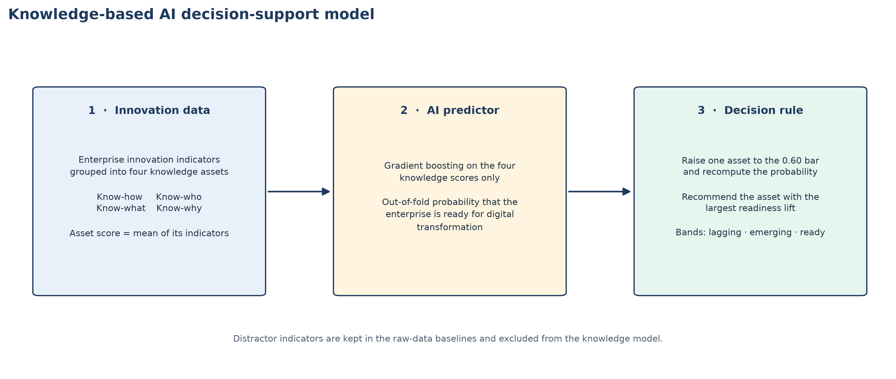
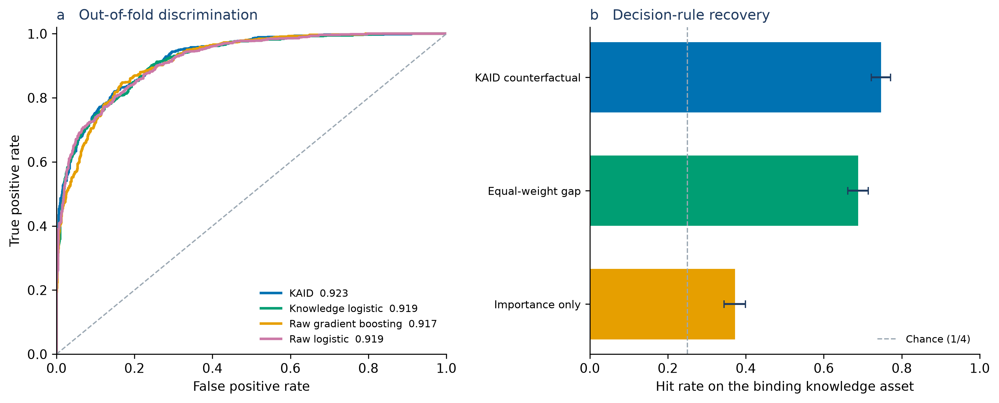

# A knowledge-based AI decision-support model for predicting digital transformation readiness from enterprise innovation data

**Short communication.** Prepared to the aim and scope of *Digital Business*: data-centric business decisions, artificial intelligence, digital transformation, innovation, and entrepreneurship.

**Author:** Durga Rao Palagiri. Add affiliation and ORCID before submission.

## Abstract

An enterprise can hold a full innovation record and still not know whether it is ready for digital transformation, or which knowledge gap to close first. This short communication proposes a knowledge-based artificial-intelligence decision-support model that answers both questions from enterprise innovation data. Indicators are grouped into four assets from the learning economy: know-how, know-who, know-what, and know-why. Gradient boosting on those four scores estimates the probability that the enterprise is ready. The recommended action raises one asset to a fixed bar of 0.60 and selects the asset with the largest increase in that probability. The study is a computational validation, not a field survey. Two thousand enterprises are simulated from a disclosed process in which readiness depends on two complementarities, know-how with know-who and know-what with know-why. A linear score on the same four assets already screens readiness well (area under the ROC curve 0.919, against a ceiling of 0.963). The boosted model reaches 0.923, and the interval on the difference includes zero. The gain is the action. Among the 1,200 enterprises that are not ready, the counterfactual rule recovers the binding asset in 74.7% of cases, against 68.8% for the largest knowledge gap and 37.2% for the asset with the greatest average importance. Use the knowledge score to screen. Use the boosted model to decide what to build next.

**Keywords:** artificial intelligence; enterprise data; knowledge-based view; digital transformation; innovation; entrepreneurship

## Highlights

- Four knowledge assets organize enterprise innovation indicators.
- Gradient boosting screens digital-transformation readiness from those assets.
- A linear knowledge score already achieves that screen.
- The gain is a counterfactual choice of the binding knowledge asset.
- The choice beats a gap rule and a global-importance rule.

## 1. Introduction

Digital transformation is a change in the enterprise, not a purchase of software. Vial (2019) defines it as a process that improves an entity by altering its properties through information, computing, communication, and connectivity technologies. Verhoef et al. (2021) show why that process fails when the supporting capabilities are missing, and Matt et al. (2015) treat the response as a strategic decision rather than an information-technology project. Entrepreneurial firms feel the constraint first. They experiment with digital offerings before they have the staff, partners, or research base to sustain them (Nambisan, 2017).

Innovation surveys already collect the raw material for that decision: training, research and development, cooperation, product and process innovation, and the use of scientific sources. What they do not collect is a single verdict. A manager who receives ten innovation indicators still has to decide whether the enterprise is ready and, if it is not, which indicator bundle to fund. Averaging the indicators hides complementarity. Ranking them by a global importance score ignores the enterprise in front of the decision maker.

The knowledge-based view gives the indicators a structure. Grant (1996) treats the enterprise as an institution for integrating specialized knowledge. Lundvall and Johnson (1994) separate that knowledge into know-what, know-why, know-how, and know-who. Cohen and Levinthal (1990) add the reason scientific sourcing matters: without absorptive capacity, external knowledge does not become internal capability. Teece (2007) supplies the decision logic. Sensing that the enterprise is not ready is not the same act as seizing the asset that would make it ready.

This note specifies a model that keeps those two acts apart. A knowledge layer compresses enterprise innovation data into the four assets. An artificial-intelligence screen estimates the probability of digital-transformation readiness. A counterfactual rule names the asset to raise. The validation is computational and fully disclosed. It answers a design question: once innovation data are represented as knowledge assets, does a boosted model improve the screen, the recommended action, or both?

## 2. The decision-support model

Figure 1 is the whole model. Enterprise innovation data enter on the left, a readiness probability leaves the middle, and one recommended asset leaves on the right. No stage is allowed to use a variable that already describes digital transformation. The predictors are innovation and knowledge indicators. Readiness is the outcome.



**Figure 1.** Knowledge-based AI decision-support model. Innovation indicators are compressed into four knowledge assets. Gradient boosting estimates the probability that the enterprise is ready for digital transformation. The decision rule raises one asset to a fixed bar and recommends the asset with the largest increase in that probability.

### 2.1 Knowledge layer

Each asset is the mean of its indicators after every indicator has been scaled to the unit interval. The mean is fixed by the construct definition. It is not a weight estimated from the readiness label, so the representation cannot be tuned to fit the outcome. Table 1 lists the mapping. Know-how covers the procedural base for executing change: training, process innovation, and research and development intensity. Know-who covers the relational base: cooperation with customers, suppliers, and universities. Know-what covers codified evidence of what the enterprise can already change: product innovation and the share of sales from innovation. Know-why covers explanatory knowledge: scientific sourcing and the share of research-driven projects. Three further indicators — plant age, fleet size, and unrelated certifications — vary across enterprises and are independent of readiness. They stay in the raw-data baselines and are excluded from the knowledge model.

**Table 1.** Knowledge assets and the enterprise innovation indicators that form them.

| Knowledge asset | Innovation indicators | Role in the decision |
| --- | --- | --- |
| Know-how | Training intensity; process innovation; R&D intensity | Procedural knowledge required to execute digital change |
| Know-who | Customer cooperation; supplier cooperation; university cooperation | Relational knowledge required to reach complementary assets |
| Know-what | Product innovation; innovation sales share | Codified knowledge of what can be transformed |
| Know-why | Scientific sourcing; research-project share | Explanatory knowledge for non-routine digital bets |

*Note.* The asset score is the arithmetic mean of its indicators. Indicators are scaled to [0, 1] before the mean is taken.

### 2.2 Artificial-intelligence screen

The screen is a histogram gradient-boosting classifier (Friedman, 2001) fit to the four asset scores and nothing else. Trees of depth three can represent a product of two scores. A linear model cannot, unless that product is handed to it as a feature. The implementation uses a learning rate of 0.06, 300 iterations, a minimum leaf size of 20, L2 regularization of 0.1, and no early stopping (Pedregosa et al., 2011). Early stopping is turned off so that a repeated run with the same seed produces the same fit.

The output is the probability that the enterprise is ready. Three bands were fixed before any result was inspected. A probability below 0.35 is lagging, a probability from 0.35 to 0.65 is emerging, and a probability above 0.65 is ready. The bands are a reporting scale for managers. They are not an optimized classification threshold. Accuracy in the comparison below uses a probability cut-off of 0.50.

Mikalef and Gupta (2021) argue that an artificial-intelligence capability is a bundle of resources, not the presence of an algorithm. The same discipline is applied here. The boosted model is the screen inside a knowledge-based decision system. It is not, by itself, the decision.

### 2.3 Counterfactual action

For an enterprise that is not ready, each asset is raised in turn to a bar of 0.60, the other three assets are left as they are, and the boosted model is scored again. The recommended asset is the one with the largest increase in predicted readiness. The bar is a managerial standard, chosen before estimation, not a quantile of the sample.

Two simpler rules are the comparison. The equal-weight gap rule recommends the asset furthest below 0.60 and ignores complementarity. The importance-only rule recommends, for every enterprise, the asset whose permutation most reduces training-fold discrimination. That rule uses the model but refuses to look at the enterprise. The proposed rule uses both.

## 3. Computational validation

Enterprise microdata that pair an innovation survey with an independent readiness label are not public. Inventing a field sample would not test the model. The test used here is a simulated population of 2,000 enterprises, drawn once, with every equation stated.

Four latent assets are drawn independently from a Beta(2, 2) distribution, which is symmetric on [0, 1] with mean 0.50. Each indicator equals its latent plus normal noise of standard deviation 0.12, then is clipped to [0, 1]. The readiness index is

*R* = 2.40 (know-how × know-who) + 1.60 (know-what × know-why).

An enterprise is ready when *R* plus normal noise of standard deviation 0.18 exceeds a cut-off. The cut-off is set so that 40% of this population is ready. The products are the point of the design. Know-how creates readiness only together with know-who, and know-what only together with know-why. The first pair has the larger coefficient. A rule that always funds the globally important asset, or that always funds whichever score is lowest, will miss enterprises whose binding constraint sits in the other pair or in the stronger partner of a pair.

The binding asset, which is the target of the decision rule, is defined on the true latents rather than on the noisy scores. It is the asset which, if raised to 0.60, increases *R* the most. The decision is scored on the 1,200 enterprises that are not ready. In this draw, every enterprise that was not ready was also below the bar on at least one true latent.

Prediction is scored on all 2,000 enterprises. Four models produce out-of-fold probabilities from the same five stratified folds, shuffled with seed 20261024:

1. KAID, the boosted model on the four knowledge scores.
2. An L2 logistic regression on the same four scores, with predictors standardized inside the fold and *C* = 1.
3. The same boosted model on the ten innovation indicators plus the three distractors.
4. An L2 logistic regression on those thirteen raw columns.

Out-of-fold probabilities are scored with the area under the ROC curve, average precision, the Brier score, expected calibration error in ten equal-width bins, and balanced accuracy at a probability cut-off of 0.50. A ceiling is the area under the ROC curve obtained by ranking enterprises on the true index *R*. No fitted model should be described as accurate without that comparison. Uncertainty is a percentile interval from 2,000 bootstrap resamples of enterprises. The resample keeps the out-of-fold scores fixed, so the interval describes sampling variation of the reported metric, not the variation that would come from refitting the model on every draw.

Internal consistency of the assets is reported with Cronbach's alpha. It is a check on the simulation, not a survey finding. Indicators that share one latent should cohere.

## 4. Results

The assets cohere. Cronbach's alpha is 0.914 for know-how, 0.912 for know-who, 0.869 for know-what, and 0.876 for know-why. The values are high because each asset was generated from a single latent. A field scale with the same names would be noisier, and the screening numbers below would fall.

Screening is already strong before boosting is introduced. Table 2 and Figure 2a report out-of-fold discrimination. The ceiling, using the true index, is 0.963. The knowledge logistic reaches 0.919. KAID reaches 0.923 (95% interval 0.911 to 0.934). Raw gradient boosting reaches 0.917 and the raw logistic reaches 0.919. The interval for KAID minus raw boosting runs from −0.000 to 0.012. The interval for KAID minus the knowledge logistic runs from −0.003 to 0.011. Both intervals include zero. Calibration tells the same story. Expected calibration error is 0.037 for KAID and 0.024 for the knowledge logistic, so the linear score is the better calibrated screen. Balanced accuracy at 0.50 is 0.828 and 0.821 respectively.

Of the out-of-fold KAID probabilities, 54.8% fall in the lagging band, 12.5% in the emerging band, and 32.8% in the ready band. The thin middle band is what a separated probability distribution looks like. It is not evidence that the cut-points were tuned.

**Table 2.** Out-of-fold screening performance on 2,000 simulated enterprises.

| Model | ROC-AUC | 95% interval | Average precision | Brier score | Calibration error | Balanced accuracy |
| --- | ---: | --- | ---: | ---: | ---: | ---: |
| KAID (boosted knowledge scores) | 0.923 | 0.911–0.934 | 0.898 | 0.111 | 0.037 | 0.828 |
| Knowledge logistic | 0.919 | 0.906–0.930 | 0.894 | 0.112 | 0.024 | 0.821 |
| Raw gradient boosting | 0.917 | 0.905–0.928 | 0.886 | 0.116 | 0.033 | 0.827 |
| Raw logistic | 0.919 | 0.907–0.930 | 0.894 | 0.112 | 0.022 | 0.820 |

*Note.* The ceiling ROC-AUC, from the true readiness index, is 0.963. Intervals are percentile bootstrap intervals with out-of-fold scores held fixed. Balanced accuracy uses a probability cut-off of 0.50. Calibration error is the expected calibration error in ten equal-width bins.

The models separate where the manager needs an action. Figure 2b reports the share of the 1,200 not-ready enterprises for which each rule names the binding asset. The KAID counterfactual is correct in 74.7% of cases (interval 0.722 to 0.771). The equal-weight gap is correct in 68.8% (0.662 to 0.714). Recommending the single most important asset is correct in 37.2% (0.344 to 0.399). Chance, with four assets, is 25%. The intervals for the counterfactual and the gap rule do not overlap.

Mean permutation importance, expressed as the drop in training-fold ROC-AUC and averaged across the five folds, is 0.186 for know-who, 0.170 for know-how, 0.104 for know-what, and 0.099 for know-why. The order follows the larger coefficient on the first product. It does not follow the needs of a given enterprise. That is why a global ranking recovers the binding asset only about three times in eight, while the counterfactual, which asks what would change for this enterprise, recovers it about three times in four.



**Figure 2.** What the model adds. **(a)** Out-of-fold ROC curves. The four screens are close, and all sit well above the diagonal. **(b)** Share of not-ready enterprises for which the rule names the binding knowledge asset. Bars are hit rates. Whiskers are 95% percentile intervals. The dashed line is chance, one asset in four.

## 5. Implications and conclusion

The result that matters is the split between screening and action. Once innovation indicators are organized as four knowledge assets, a linear score is enough to say whether an entrepreneurial enterprise is a plausible candidate for digital transformation. Spending the modeling effort on a more flexible screen does not buy a reliable gain in discrimination, and it slightly worsens calibration. The boosted model earns its place one step later. Because readiness is a product of paired assets, the asset furthest below a bar is not always the asset whose repair would raise readiness most. Intervening inside the fitted model recovers that asset more often than the gap, and much more often than the asset the model finds important on average.

For an entrepreneurial firm the sequence is practical. Compute the four scores from indicators the firm already reports. If the linear probability is low, do not open a transformation program on the strength of a technology purchase. Ask the boosted model which single asset, raised to the 0.60 bar, moves the probability most. Fund that asset: a training and process-innovation effort when know-how is the constraint, a customer or university partnership when know-who is the constraint, or a research link when know-why is binding even though its average importance is smaller. The average importance list is a poor substitute for that question. Know-who and know-how dominate it, yet for a large minority of not-ready enterprises the binding asset is elsewhere.

The evidence stops at the simulation. The population has one complementarity structure, reliable indicators, no budget constraint, and no implementation lag. The 40% label uses a cut-off computed on the same simulated population. The bootstrap does not refit the model. Field instruments built from the same four names will have lower internal consistency than the alphas reported here, and screening accuracy will decline with them. The next test is empirical: the same four scores, the same bar, and the same counterfactual, applied to an innovation survey whose readiness label was collected independently. Until that test is done, the honest claim is a design claim. Knowledge structure does the screening. The artificial-intelligence model is justified by the quality of the action it recommends.

## Replication

The population, the four models, both figures, and `results.json` are produced by `kb_dt_model.py` with seed 20261024. The run reported here used NumPy 2.2.6, scikit-learn 1.9.1, and Matplotlib 3.11.2. From the repository root:

```bash
python -m pip install -r requirements.txt
python kb_dt_model.py
```

A second run with the same seed rewrites the figures and the result file. The metrics in Table 2 and Figure 2 are that file.

## References

Cohen, W. M., & Levinthal, D. A. (1990). Absorptive capacity: A new perspective on learning and innovation. *Administrative Science Quarterly, 35*(1), 128–152. https://doi.org/10.2307/2393553

Friedman, J. H. (2001). Greedy function approximation: A gradient boosting machine. *Annals of Statistics, 29*(5), 1189–1232. https://doi.org/10.1214/aos/1013203451

Grant, R. M. (1996). Toward a knowledge-based theory of the firm. *Strategic Management Journal, 17*(S2), 109–122. https://doi.org/10.1002/smj.4250171110

Lundvall, B.-Å., & Johnson, B. (1994). The learning economy. *Journal of Industry Studies, 1*(2), 23–42. https://doi.org/10.1080/13662719400000002

Matt, C., Hess, T., & Benlian, A. (2015). Digital transformation strategies. *Business & Information Systems Engineering, 57*(5), 339–343. https://doi.org/10.1007/s12599-015-0401-5

Mikalef, P., & Gupta, M. (2021). Artificial intelligence capability: Conceptualization, measurement calibration, and empirical study on its impact on organizational creativity and firm performance. *Information & Management, 58*(3), 103434. https://doi.org/10.1016/j.im.2021.103434

Nambisan, S. (2017). Digital entrepreneurship: Toward a digital technology perspective of entrepreneurship. *Entrepreneurship Theory and Practice, 41*(6), 1029–1055. https://doi.org/10.1111/etap.12254

Pedregosa, F., Varoquaux, G., Gramfort, A., Michel, V., Thirion, B., Grisel, O., Blondel, M., Prettenhofer, P., Weiss, R., Dubourg, V., Vanderplas, J., Passos, A., Cournapeau, D., Brucher, M., Perrot, M., & Duchesnay, É. (2011). Scikit-learn: Machine learning in Python. *Journal of Machine Learning Research, 12*, 2825–2830.

Teece, D. J. (2007). Explicating dynamic capabilities: The nature and microfoundations of (sustainable) enterprise performance. *Strategic Management Journal, 28*(13), 1319–1350. https://doi.org/10.1002/smj.640

Verhoef, P. C., Broekhuizen, T., Bart, Y., Bhattacharya, A., Dong, J. Q., Fabian, N., & Haenlein, M. (2021). Digital transformation: A multidisciplinary reflection and research agenda. *Journal of Business Research, 122*, 889–901. https://doi.org/10.1016/j.jbusres.2019.09.022

Vial, G. (2019). Understanding digital transformation: A review and a research agenda. *The Journal of Strategic Information Systems, 28*(2), 118–144. https://doi.org/10.1016/j.jsis.2019.01.003
